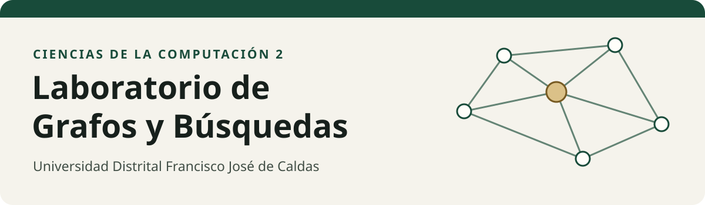
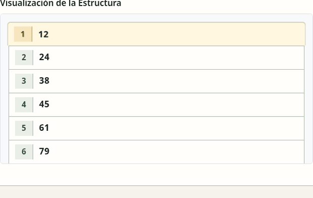
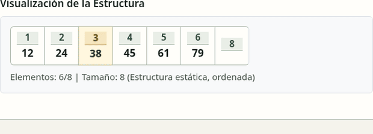
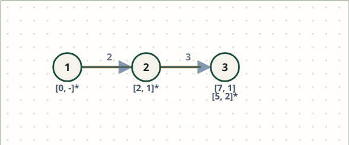
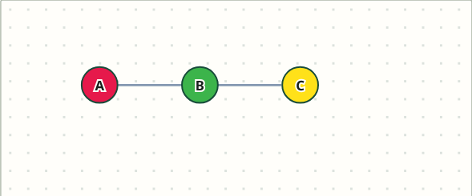
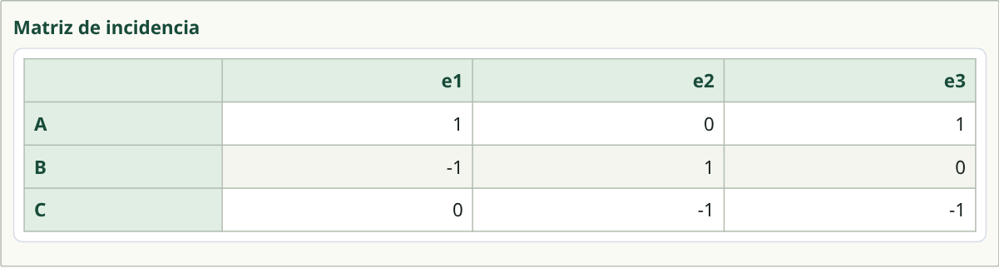
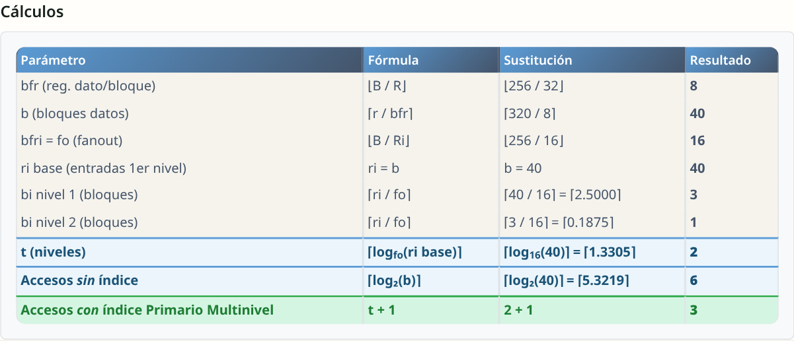

<p align="center">
  
</p>

<p align="center">
  <strong>Simulador académico para construir grafos, practicar búsquedas y visualizar sus resultados.</strong>
</p>

<p align="center">
  <a href="#demo"><strong>Ver demo</strong></a> ·
  <a href="#arranque-local">Iniciar el simulador</a> ·
  <a href="manuales/manual-usuario.pdf">Manual de usuario (PDF)</a> ·
  <a href="#módulos">Explorar los módulos</a>
</p>

## Demo

**La misma clave, dos recorridos.** Pulsa **Ejemplo** en cada método para cargar la misma estructura de seis claves y buscar `45`. Las grabaciones muestran cómo la búsqueda secuencial recorre la lista y cómo la binaria acota el intervalo.

| Búsqueda secuencial | Búsqueda binaria |
| :---: | :---: |
|  |  |
| Posición 4, cuatro pasos. | Posición 4, tres pasos. |

## Galería

<table>
  <tr>
    <td width="50%"><strong>Dijkstra</strong><br>Compara el costo de un camino directo con una ruta de menor peso.</td>
    <td width="50%"><strong>Coloreado</strong><br>Observa cómo se asignan colores distintos a vértices adyacentes.</td>
  </tr>
  <tr>
    <td></td>
    <td></td>
  </tr>
</table>

<details>
<summary><strong>Ver matrices e índices multinivel</strong></summary>

| Matriz de incidencia | Índice multinivel |
| --- | --- |
| Relaciona los vértices con las aristas. | Presenta los bloques y niveles calculados. |
|  |  |

</details>

## Módulos

| Área | Métodos y ejercicios |
| --- | --- |
| **Búsquedas internas** | Secuencial, binaria, hash y residuos. |
| **Búsquedas externas** | Secuencial y binaria por bloques, hash externo y búsqueda dinámica. |
| **Índices** | Índices de un nivel y multinivel. |
| **Grafos** | Operaciones con uno o dos grafos, árboles, función ordinal, Bellman, Dijkstra, Floyd, matrices, conjuntos y coloreado. |

Los **26 métodos** incluyen un botón **Ejemplo** para comenzar con datos preparados. Puedes cambiar los datos, volver a ejecutar el método y guardar el ejercicio en JSON desde los módulos que ofrecen esa opción.

## Arranque local

Clona el repositorio y ejecuta estos comandos desde la terminal. El servidor local requiere Python 3.

```bash
git clone https://github.com/PL-Ticonsky/SimuladorCC2.git
cd SimuladorCC2
python3 -m http.server 8000 --bind 127.0.0.1
```

Abre [localhost:8000](http://localhost:8000/), elige **Búsquedas** o **Grafos** y pulsa **Ejemplo** dentro de un método. Para detener el servidor, presiona **Ctrl+C** en la terminal.

El simulador usa HTML, CSS y JavaScript. Bootstrap y D3 se incluyen en el repositorio y los algoritmos se ejecutan en el navegador.

## Documentación

- **[Manual de usuario en PDF](manuales/manual-usuario.pdf)** con prácticas paso a paso y capturas.
- **[Fuente LaTeX](manuales/manual-usuario.tex)** y **[capturas del manual](manuales/capturas/)** para recompilarlo.
- **Manuales de usuario y técnico** en la pestaña **Documentación** del simulador.

Desarrollado para **Ciencias de la Computación 2**, Universidad Distrital Francisco José de Caldas.

## Licencias

- **Proyecto:** [GNU General Public License, versión 3](LICENSE).
- **Dependencias incluidas:** [avisos y licencias de terceros](docs/licencias.md).
